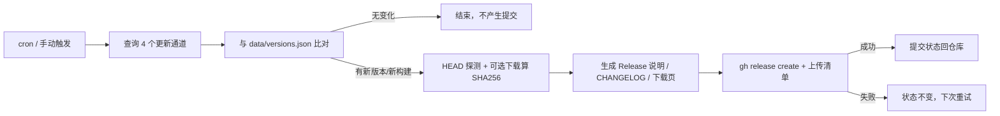

# WorkBuddy Linux Releases

> 每天自动检查腾讯官方更新接口的 4 个 Linux 通道，一旦发现新版本就自动创建 GitHub Release，并刷新可直接下载的页面。

WorkBuddy 官网的 Linux 一栏只写了「请到统信 UOS / 银河麒麟应用商店下载」，但官方其实构建了通用 deb / rpm 包，只是没挂出来：未公开的更新接口 `https://copilot.tencent.com/v2/update?platform=<channel>` 会直接返回最新版本、下载地址和包元数据。这个项目把该接口做成**可持续追踪、可订阅、可回溯**的发布管道。

思路来自 [姓王者的博客：WorkBuddy 没给 Ubuntu/Fedora 留下载入口？官方的 deb 和 rpm 都找到了](https://xingwangzhe.fun/posts/workbuddy-linux-deb-rpm/)（CC BY-NC-SA 4.0）。

## 它做什么

| 环节 | 行为 |
| --- | --- |
| 定时检查 | 每天 UTC 01:23（北京 09:23）查询 4 个通道：`x64/arm64 × deb/rpm` |
| 变更判定 | 版本变化（升/降）、同版本重新构建（URL 里的构建号变化）都会触发；无变化时不产生任何提交 |
| 校验 | 对变更通道实际下载并计算真实 SHA256；上游 `sha256hash` 只记录、不当校验值（原文实测两者不一致） |
| 自动发布 | 生成 Release 说明、JSON 清单，创建 `v<版本>` Release，附 `manifest.json` |
| 幂等 | 发布前 `gh release view` 查重；**先发布、后提交状态**，发布失败下次自动重试，不会重复发版 |
| 持续更新 | 自动写回 `data/versions.json`、`CHANGELOG.md`、本页下载表和 `docs/` 下载页 |

默认**不把安装包本体上传到 Release**（四个包合计约 1.6 GiB，且属于腾讯专有软件）：Release 只保存元数据与官方直链。需要自托管镜像时打开 `mirror` 开关即可。

## 当前四个通道

<!-- AUTOGEN:DOWNLOADS:START -->
| 架构 | 包格式 | 适用发行版 | 版本 | 大小 | 下载 |
| --- | --- | --- | --- | --- | --- |
| x86_64 (amd64) | `deb` | Ubuntu / Debian / UOS / deepin / openKylin | `5.6.2.40046327` | 409.9 MiB | [下载 deb](https://download.codebuddy.cn/workbuddy/saas/linux-x64-deb/WorkBuddy-linux-x64-deb-5.6.2.40046327-c7b525f3.deb) |
| x86_64 (amd64) | `rpm` | Fedora / RHEL / openSUSE | `5.6.2.40046327` | 360.7 MiB | [下载 rpm](https://download.codebuddy.cn/workbuddy/saas/linux-x64-rpm/WorkBuddy-linux-x64-rpm-5.6.2.40046327-c7b525f3.rpm) |
| ARM64 (aarch64) | `deb` | Ubuntu / Debian / UOS / deepin / openKylin | `5.6.2.40046327` | 381.5 MiB | [下载 deb](https://download.codebuddy.cn/workbuddy/saas/linux-arm64-deb/WorkBuddy-linux-arm64-deb-5.6.2.40046327-c7b525f3.deb) |
| ARM64 (aarch64) | `rpm` | Fedora / RHEL / openSUSE | `5.6.2.40046327` | 339.1 MiB | [下载 rpm](https://download.codebuddy.cn/workbuddy/saas/linux-arm64-rpm/WorkBuddy-linux-arm64-rpm-5.6.2.40046327-c7b525f3.rpm) |
<!-- AUTOGEN:DOWNLOADS:END -->

> 不确定架构？终端运行 `uname -m`：`x86_64` 选 x64，`aarch64` 选 ARM64。

## 一键安装（始终拿最新版）

Ubuntu / Debian / UOS / deepin / openKylin：

```bash
url=$(curl -fsSL "https://copilot.tencent.com/v2/update?platform=workbuddy-linux-x64-deb" | jq -r '.url')
curl -fL -O "$url"
sha256sum WorkBuddy-linux-x64-deb-*.deb
sudo apt install ./WorkBuddy-linux-x64-deb-*.deb
```

Fedora / RHEL / openSUSE：

```bash
url=$(curl -fsSL "https://copilot.tencent.com/v2/update?platform=workbuddy-linux-x64-rpm" | jq -r '.url')
curl -fL -O "$url"
sha256sum WorkBuddy-linux-x64-rpm-*.rpm
sudo dnf install ./WorkBuddy-linux-x64-rpm-*.rpm
```

ARM64 把 platform 里的 `x64` 换成 `arm64`。**不要硬编码下载 URL**：链接里的构建号每次发版都会变。

## 部署你自己的一份

1. 把本仓库推到 GitHub（新建空仓库，不要带 README）。
   ```bash
   git remote add origin git@github.com:<OWNER>/<REPO>.git
   git push -u origin main
   ```
2. **Settings → Actions → General → Workflow permissions** 选 `Read and write permissions`（创建 Release、回写版本数据需要 `contents: write`）。
3. **Actions → 每日检查并发布 WorkBuddy Linux 新版本 → Run workflow**。仓库里的数据已用真实接口预填充并标记 `baseline: true`，首次运行会补发一个初始 Release，之后只在真有新版本时发布。
4. **Settings → Pages → Build and deployment**：`Deploy from a branch`，分支 `main`，目录 `/docs`。保存后得到 `https://<OWNER>.github.io/<REPO>/` 下载页。
5. 订阅更新：仓库右上角 **Watch → Custom → Releases**；或用 RSS：`https://github.com/<OWNER>/<REPO>/releases.atom`。

定时表达式在 [`.github/workflows/check-release.yml`](.github/workflows/check-release.yml) 的 `cron` 一行修改。

## 配置项

| 位置 | 名称 | 默认值 | 说明 |
| --- | --- | --- | --- |
| Repo variable | `WB_VERIFY_CHECKSUMS` | `true` | 下载变更通道的安装包计算真实 SHA256；设为 `false` 可省流量 |
| Repo variable | `WB_MIRROR_ASSETS` | `false` | 把 `.deb`/`.rpm` 本体上传为 Release 附件（自动开启校验） |
| Repo variable | `WB_ALLOWED_DOWNLOAD_HOSTS` | 空 | CDN 换域名时追加允许的主机（逗号分隔），不要关掉 URL 校验 |
| Dispatch input | `force` | `false` | 把所有通道视为有变更，重生成文档/说明；已存在的 Release 仍会跳过 |
| Dispatch input | `verify` | `default` | `true` / `false` / `default`（跟随变量） |
| Dispatch input | `mirror` | `default` | `true` / `false` / `default`（跟随变量） |
| Dispatch input | `dry_run` | `false` | 只演练，不写文件、不建 Release |



## 发布规则

- 四个通道通常同版本、同构建号，合并为一个 Release：`v5.6.2.40046327`。
- 同版本但重新构建（构建号变化）→ `v<版本>-<构建号>`，避免覆盖历史。
- 通道各自失败互不影响：某个通道查询失败时保留上次记录，其余通道照常发布。
- `data/versions.json` 是唯一状态源；`data/history.jsonl` 追加式记录每次发布。

## 目录结构

```
.
├── .github/workflows/
│   ├── check-release.yml     # 每日检查 + 自动发布
│   └── ci.yml                # 单元测试 + 离线端到端演练
├── src/wb_release/
│   ├── config.py             # 四个通道、接口地址、允许主机
│   ├── net.py                # 接口抓取、URL 白名单校验、HEAD、下载算哈希
│   ├── state.py              # 版本比对、状态持久化、Release 分组
│   ├── render.py             # Release 说明 / 下载表 / CHANGELOG / badge
│   └── cli.py                # check / seed 子命令
├── tests/                    # 30 个离线单元测试 + 两套接口 fixture
├── data/
│   ├── versions.json         # 当前状态（Actions 自动写回）
│   └── history.jsonl         # 发布历史
├── docs/
│   ├── index.html            # GitHub Pages 下载页（含 Actions 写入的内嵌快照）
│   ├── versions.json         # 下载页数据源
│   └── latest.json           # shields.io endpoint badge 数据
└── dist/                     # gitignored，Release 说明与可选镜像附件
```

## 本地开发

零第三方依赖，只用 Python 标准库（要求 ≥ 3.10）：

```bash
PYTHONPATH=src python -m unittest discover -s tests -v

# 用真实接口重建基准数据（只发 8 个轻量请求，不下载安装包）
PYTHONPATH=src python -m wb_release seed --root .

# 离线演练：不联网、不写文件
PYTHONPATH=src python -m wb_release check \
  --root . --fixtures tests/fixtures/upstream-next.json \
  --no-verify --no-probe --dry-run
```

`--fixtures` 用本地 JSON 替代接口，`--dry-run` 只计算不落盘，CI 里也是靠这两个开关做端到端演练。

## 风险与说明

- 更新接口是**未公开接口**，随时可能改动或下线；脚本对异常 JSON、非白名单域名、错误包类型都会明确报错，不会把可疑链接发布出去。
- `sha256hash` 字段与文件实测值可能不一致，本项目把它与实测值分列展示，安装前请自行 `sha256sum` 校验。
- `supportsFastUpdate: false`，Linux 应用内更新会指向官网，而官网没有 Linux 入口；升级仍需重新下载安装包。
- 龙芯（LoongArch）无官方包；deepin 商店里的版本是社区移植，本仓库不追踪。
- 本项目只追踪**官方直链与元数据**，不重新分发、不修改安装包；包版权归腾讯所有。

## 许可证与致谢

本仓库代码采用 [MIT](LICENSE)。内容与思路参考[原文](https://xingwangzhe.fun/posts/workbuddy-linux-deb-rpm/)（署名-非商业性使用-相同方式共享 4.0），文中命令与结论经 2026-11-11 实测复核；原文以链接方式引用，未复制正文。
